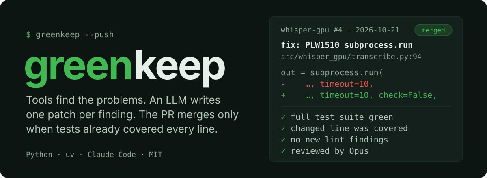
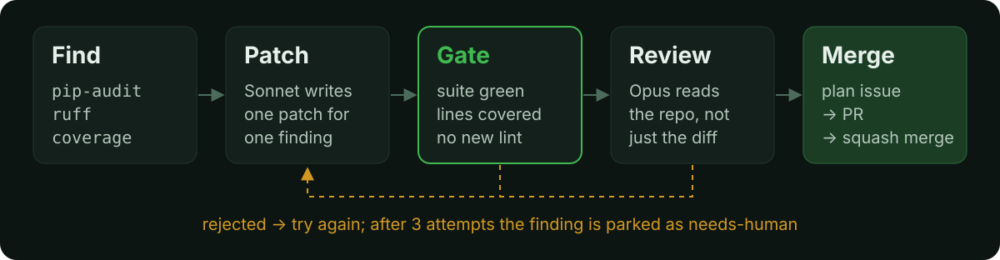

<p align="center"></p>

[](https://github.com/octrow/greenkeep/actions/workflows/test.yml)
[](https://github.com/octrow/greenkeep/releases/latest)
[](pyproject.toml)
[](LICENSE)

<p><b>English</b> | <a href="README.ru.md">Русский</a></p>

greenkeep fixes your own Python repositories on a schedule, one small tested patch at a time.

Tools find the problems. An LLM writes one patch per finding. The fix PR merges itself only when the full test suite passes and tests already covered every changed line.

It is for a developer with many pet projects who wants small, safe fixes without reviewing each by hand. Each PR names the model and the prompt hash that made the patch.

## What a fix PR looks like

A real one: [whisper-gpu#4](https://github.com/octrow/whisper-gpu/pull/4), ruff `PLW1510`, merged 2026-10-21. Sonnet wrote the patch, Opus reviewed it, and greenkeep wrote the PR body:

```diff
    PLW1510: `subprocess.run` without explicit `check` argument (src/whisper_gpu/transcribe.py:94)

    Finding: `PLW1510` at `src/whisper_gpu/transcribe.py:94`: `subprocess.run` without explicit `check` argument
    Patched by: `claude-sonnet-5-5` (prompt `9f811a4332db`), reviewed by: `claude-opus-5-5`
    Gate: full test suite green; every changed line was covered before the change; no new lint findings.

    Closes #3

     try:
         out = subprocess.run(
             ["nvidia-smi", "--query-gpu=memory.free", "--format=csv,noheader,nounits"],
-            capture_output=True, text=True, timeout=10,
+            capture_output=True, text=True, timeout=10, check=False,
         )
```

greenkeep opened plan issue #3 first, and the PR closed it on merge. A dry run (no `--push`) makes the same change in a throwaway clone and only reports it.

First week on the author's 19 repos: 32 PRs merged in 16 repos, most of them dependency fixes and lint fixes. Details, including the 4 PRs judged bad: [docs/results.md](docs/results.md).

## Install

Linux and macOS:

```bash
curl -LsSf https://raw.githubusercontent.com/octrow/greenkeep/main/install.sh | sh
```

Windows (PowerShell):

```powershell
powershell -ExecutionPolicy ByPass -c "irm https://raw.githubusercontent.com/octrow/greenkeep/main/install.ps1 | iex"
```

The script installs [uv](https://docs.astral.sh/uv/) if it is missing, then the wheel from the latest release. Run it again to update. `... | sh -s -- --uninstall` removes greenkeep.

To read the script first, download `install.sh` and run `sh install.sh`. Or install with uv:

```bash
uv tool install git+https://github.com/octrow/greenkeep
```

You also need:

- git, and the [GitHub CLI](https://cli.github.com/) logged in with `gh auth login` (only for `--push`);
- [Claude Code](https://docs.claude.com/en/docs/claude-code) logged in, called as plain `claude -p` through [claude-subprocess](https://github.com/octrow/claude-cli). Your Claude Code account pays. Sonnet writes patches. Opus reviews them.

## Usage

```bash
greenkeep ~/dev/repo-a ~/dev/repo-b          # dry run: nothing leaves the machine except LLM calls
greenkeep ~/dev/repo-a --push --budget 3     # open issues and PRs, merge on green, at most 3 merges today
greenkeep --push                             # the scheduled run, over the repos in the config
```

| Option | Default | What it does |
|---|---|---|
| `--push` | off | Open a plan issue and a fix PR, wait for the required checks, squash-merge |
| `--budget N` | config, 3 | Merged fix PRs today, across all repos |
| `--model NAME` | `claude-sonnet-5-5` | Claude Code model that writes the patches |
| `--review-model NAME` | `claude-opus-5-5` | Claude Code model that reviews each patch inside the clone |
| `--keep` | off | Keep the throwaway clones in `~/.cache/greenkeep` for inspection |

A run makes at most one fix per repo, so run it on a schedule. State lives in `~/.local/share/greenkeep/state.db`. A dry run never writes it. Logs: [docs/configuration.md](docs/configuration.md#logs).

Config file, systemd timer, Telegram digest, pause and dashboard: [docs/configuration.md](docs/configuration.md).

## What a repo needs

- Python managed with uv: a `pyproject.toml` at the root (`uv sync` must work).
- Tests that pytest can run and that pass today. A repo with no tests is fine: greenkeep starts by writing characterization tests.
- For `--push`: a GitHub remote you can push to and merge into.

## How it works

<p align="center"></p>

1. Clone: each repo is cloned into `~/.cache/greenkeep`. Your checkout is never touched. If tests are already red, an Opus agent gets one try per commit to fix them, or the repo is skipped.
2. Find: only deterministic tools produce findings: pip-audit, ruff, coverage, outdated dependencies and readiness checks. An opt-in bug hunt adds bugs the model suspects, each fixed test first.
3. Patch: the LLM gets one finding and its code, and returns SEARCH/REPLACE edits. For an untested module it writes tests that pin down what the code does today.
4. Gate: the change stays only if the full suite passes, tests covered every changed line before, and ruff reports nothing new. Then Opus reviews it in the clone and reads the whole repo.
5. Merge or park: a passing change is committed. With `--push` it becomes a PR and merges on green. A finding gets three attempts, then it is parked until a commit changes its file ([ADR 0004](docs/adr/0004-no-human-in-the-loop.md)).

Why deterministic findings and not a free-roaming agent: [ADR 0001](docs/adr/0001-deterministic-findings-llm-patches.md). Terms: [CONTEXT.md](CONTEXT.md). Comparison with Dependabot, ruff `--fix` and coding agents: [docs/comparison.md](docs/comparison.md).

## Status

In daily use on the author's repos since 2026-10-16.

Done: findings from ruff, coverage and dependencies. The gate. Sonnet patcher and Opus reviewer. Issue, PR and merge. Hourly timer, digest, pause and dashboard.

Also done: cool-down for failing repos, revert when CI on main goes red, opt-in bug hunt, readiness checks.

Next:

1. Bug hunt in uncovered code. Today it only hunts modules at 50%+ coverage.
2. JS/TS as a second language plugin.

Design: [CONTEXT.md](CONTEXT.md) (glossary), [docs/adr](docs/adr) (decisions).

## Contributing and security

See [CONTRIBUTING.md](CONTRIBUTING.md) and [SECURITY.md](SECURITY.md). Changes: [CHANGELOG.md](CHANGELOG.md).

## License

[MIT](LICENSE)
