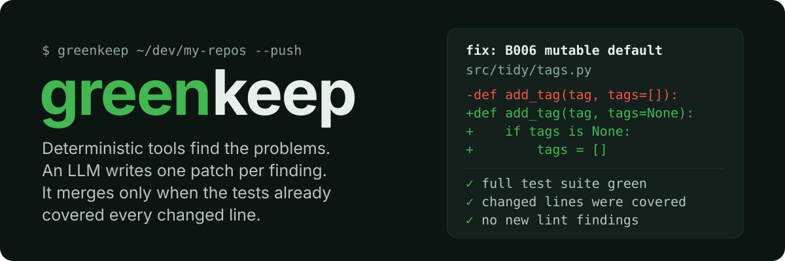

<p align="center"></p>

[](https://github.com/octrow/greenkeep/actions/workflows/test.yml)
[](https://github.com/octrow/greenkeep/releases/latest)
[](pyproject.toml)
[](LICENSE)

<p><b>English</b> | <a href="README.ru.md">Русский</a></p>

greenkeep is a scheduled, gated maintainer for your own Python repositories. Deterministic tools find the problems, an LLM writes one patch per finding, and the fix PR auto-merges only when the full test suite passes and every changed line was already covered by tests. It's for a developer with a pile of pet projects who wants them to keep getting small, safe fixes without reviewing each one by hand.

Every fix PR resolves one finding, and its commit message names the model and the prompt hash that produced the patch.

## What a run looks like

A real dry run on a small demo repo with a mutable default argument (ruff `B006`). The patch came from a free-tier model through OmniRoute; the whole run took about 10 seconds:

```console
$ greenkeep ~/dev/tidy --keep
tidy: B006: Do not use mutable data structures for argument defaults (src/tidy/tags.py)
  merged B006: Do not use mutable data structures for argument defaults (src/tidy/tags.py) via gemini-3.8-flash-tiered
```

```diff
    fix: B006: Do not use mutable data structures for argument defaults (src

    Finding: `B006` at `src/tidy/tags.py:1`: Do not use mutable data structures for argument defaults
    Patched by: `gemini-3.8-flash-tiered` (prompt `cbd0ba095834`)
    Gate: full test suite green; every changed line was covered before the change; no new lint findings.

-def add_tag(tag, tags=[]):
+def add_tag(tag, tags=None):
+    if tags is None:
+        tags = []
     tags.append(tag.strip().lower())
     return tags
```

In a dry run, "merged" means merged into a throwaway clone. With `--push` the same change becomes a plan issue and a fix PR on GitHub, which is squash-merged once the required CI checks pass.

## How it works

1. Clone: each repo you pass is cloned into `~/.cache/greenkeep`; your checkout is never touched. If its tests are red before greenkeep changes anything, the repo is skipped.
2. Find: findings come from deterministic tools only: ruff (security, bug and pyflakes rules first) and coverage (modules with no tests at all).
3. Patch: for each finding the LLM gets the finding and its code and returns SEARCH/REPLACE edits. For an untested module it writes characterization tests that pin down what the code does today.
4. Gate: the change is kept only if the full suite passes, every changed line was covered before the change (for a new test file: module coverage grew), and ruff reports nothing new.
5. Merge or park: a passing change is committed (and with `--push`, opened as a PR and merged on green). A finding gets three attempts; after that it is parked and labelled `needs-human`.

Why deterministic findings and not a free-roaming coding agent: [ADR 0001](docs/adr/0001-deterministic-findings-llm-patches.md). Terms used here: [CONTEXT.md](CONTEXT.md).

## Install

Linux and macOS:

```bash
curl -LsSf https://raw.githubusercontent.com/octrow/greenkeep/main/install.sh | sh
```

Windows (PowerShell):

```powershell
powershell -ExecutionPolicy ByPass -c "irm https://raw.githubusercontent.com/octrow/greenkeep/main/install.ps1 | iex"
```

The script installs [uv](https://docs.astral.sh/uv/) if it's missing, then the wheel from the latest release. Run it again to update; `... | sh -s -- --uninstall` removes greenkeep. To read the script before running it, download `install.sh` and run `sh install.sh`. Or install with uv directly:

```bash
uv tool install git+https://github.com/octrow/greenkeep
```

You also need:

- git, and the [GitHub CLI](https://cli.github.com/) logged in with `gh auth login` (only for `--push`);
- an [OmniRoute](https://github.com/diegosouzapw/OmniRoute) gateway: the key in `OMNIROUTE_API_KEY` or `~/.omniroute/.env`, the address in `OMNIROUTE_URL` (default `http://localhost:20128`).

## Usage

```bash
greenkeep ~/dev/repo-a ~/dev/repo-b          # dry run: nothing leaves the machine except LLM calls
greenkeep ~/dev/repo-a --push --budget 3     # open issues and PRs, merge on green, at most 3 merges a day
```

| Option | Default | What it does |
|---|---|---|
| `--push` | off | Open a plan issue and a fix PR, wait for the required checks, squash-merge |
| `--budget N` | 3 | Merged fix PRs per day, across all repos |
| `--model NAME` | `free-stack` | OmniRoute model or combo that writes the patches |
| `--keep` | off | Keep the throwaway clones in `~/.cache/greenkeep` for inspection |

A run makes at most one fix per repo, so it's meant to run on a schedule. A daily cron line is enough:

```cron
0 6 * * * $HOME/.local/bin/greenkeep $HOME/dev/repo-a $HOME/dev/repo-b --push >> $HOME/.local/state/greenkeep.log 2>&1
```

State (attempts per finding, merges per day) lives in `~/.local/share/greenkeep/state.db`. A dry run never writes it.

## What a repo needs

- Python, managed with uv: a `pyproject.toml` at the root (`uv sync` must work).
- Tests that pytest can run and that pass today. A repo with no tests at all is fine: greenkeep starts by writing characterization tests.
- For `--push`: a GitHub remote you can push to and merge into.

## How it differs

- Dependabot, Renovate: they bump dependencies. greenkeep doesn't bump anything yet; it fixes code findings and adds tests. Both can run on the same repo.
- ruff `--fix`, pre-commit.ci autofix: they apply only the fixes ruff can make mechanically. greenkeep uses ruff's safe fix when there is one and calls the LLM only for findings ruff can't fix, like `B006` above; both kinds go through the same gate and get their own PR.
- Coding agents (Copilot coding agent, OpenHands, Sweep): an agent decides what to change and how much. Here a deterministic tool picks the problem, the patch is limited to one finding, and nothing merges unless tests already covered every line it touched. The agents can do more; greenkeep aims to be boring and repeatable.
- [patchwork](https://github.com/patched-codes/patchwork): closest in spirit (AutoFix flows). It doesn't own the schedule, the daily budget, the coverage gate or the issue → PR → merge loop, and greenkeep is built around those.

## Status

Version 0.1 is one end-to-end slice: Python repos, ruff findings and characterization tests. Planned (terms in [CONTEXT.md](CONTEXT.md)): more finding sources (type checker, security and dependency scanners), test-first fixes for uncovered bugs, readiness checks, a Telegram digest after each run, and auto-pause when greenkeep's own merges get reverted.

## Contributing and security

See [CONTRIBUTING.md](CONTRIBUTING.md) and [SECURITY.md](SECURITY.md). Changes: [CHANGELOG.md](CHANGELOG.md).

## License

[MIT](LICENSE)

## How a run works

1. Clone each tended repo into a throwaway directory (the local checkout is only read).
2. Baseline: `uv sync`, then the full test suite under coverage. Red baseline → skip the repo.
3. Findings, in work order: known vulnerabilities (pip-audit), ruff bugs, modules with
   little or no test coverage, outdated dependencies (same major), ruff style.
4. Per finding, up to 3 attempts: a deterministic ruff fix or an LLM patch (Sonnet), then the
   gate — only allowed files touched, changed lines covered before the change, no new lint, no
   `noqa`-style suppressions, full suite green — then an LLM review (Opus).
5. A plan issue, a PR that closes it, squash merge once required CI checks pass.
6. A digest of the run goes to Telegram.

At most one merge per repo per run and a daily budget across all repos.

## Use

```bash
uv run greenkeep ~/dev/some-repo            # dry run: commits in a throwaway clone, no state
uv run greenkeep --push                     # the real thing, over the config's repos
```

Config `~/.config/greenkeep/config.toml`:

```toml
budget = 3            # merged PRs per weekday
weekend_budget = 1
repos = ["~/dev/my-repo", "owner/name-without-local-checkout"]
```

Telegram digest: `GREENKEEP_TG_BOT_TOKEN` and `GREENKEEP_TG_CHAT_ID` in
`~/.config/greenkeep/env` (without them: desktop notification). Full log:
`~/.local/state/greenkeep/greenkeep.log`. Pause: `touch ~/.config/greenkeep/PAUSE`.

Daily at 10:00:

```bash
cp contrib/systemd/greenkeep.* ~/.config/systemd/user/
systemctl --user daemon-reload && systemctl --user enable --now greenkeep.timer
```

## Status and roadmap

Done: ruff, coverage and dependency findings (vulnerabilities bypass the daily budget;
upgrades need 60% coverage), gate, Sonnet patcher + Opus reviewer, issue → PR → merge,
config, daily timer, digest, pause, auto-pause (a reverted greenkeep merge stops all
runs until you delete the pause file, which says which merge it was).

Next, roughly in this order:

1. **Revival**, if more repos need it (today only LaptopLoot): move a `requirements.txt`
   repo to uv + `pyproject.toml`.
2. **Dashboard** of runs and findings (nicegui-kit).
3. **Bug hunt**: LLM-found bugs (Hunter → Skeptic → Referee) through the same gate.
4. **Readiness checks** (license, metadata, README sections, CI badge) for new repos; the
   current public ones already pass them.
5. JS/TS as a second language plugin.

Design: [CONTEXT.md](CONTEXT.md) (glossary), [docs/adr](docs/adr) (decisions).
