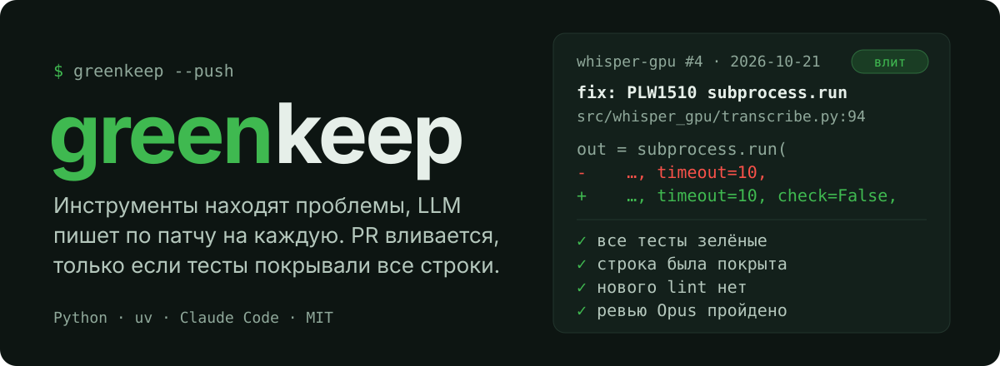
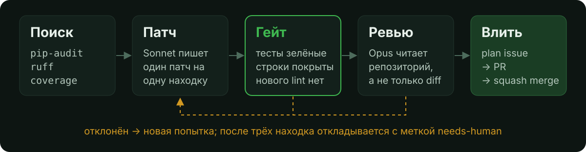

<p align="center"></p>

[](https://github.com/octrow/greenkeep/actions/workflows/test.yml)
[](https://github.com/octrow/greenkeep/releases/latest)
[](pyproject.toml)
[](LICENSE)


<p><a href="README.md">English</a> | <b>Русский</b></p>

greenkeep чинит ваши Python-репозитории по расписанию, по одному маленькому проверенному патчу.

Проблемы находят инструменты. LLM пишет по одному патчу на находку. PR с исправлением вливается сам, только если весь набор тестов зелёный и тесты уже покрывали каждую изменённую строку.

Он для разработчика с кучей pet-проектов, который хочет мелких безопасных исправлений без ручного ревью каждого. В каждом PR указаны модель и хэш промпта, которые дали патч.

## Как выглядит fix PR

Настоящий: [whisper-gpu#4](https://github.com/octrow/whisper-gpu/pull/4), ruff `PLW1510`, влит 2026-10-21. Патч написал Sonnet, Opus его проверил, текст PR написал greenkeep:

```diff
    PLW1510: `subprocess.run` without explicit `check` argument (src/whisper_gpu/transcribe.py:94)

    Finding: `PLW1510` at `src/whisper_gpu/transcribe.py:94`: `subprocess.run` without explicit `check` argument
    Patched by: `claude-sonnet-5-5` (prompt `9f811a4332db`), reviewed by: `claude-opus-5-5`
    Gate: full test suite green; every changed line was covered before the change; no new lint findings.

    Closes #3

     try:
         out = subprocess.run(
             ["nvidia-smi", "--query-gpu=memory.free", "--format=csv,noheader,nounits"],
-            capture_output=True, text=True, timeout=10,
+            capture_output=True, text=True, timeout=10, check=False,
         )
```

Сначала greenkeep открыл plan issue #3, при слиянии PR закрыл его. Пробный запуск (без `--push`) делает то же изменение в одноразовом клоне и только сообщает о нём.

Первая неделя на 19 репозиториях автора: влито 32 PR в 16 репозиториях, в основном исправления зависимостей и линтера. Подробности, включая 4 PR, признанных плохими: [docs/results.ru.md](docs/results.ru.md).

## Установка

Linux и macOS:

```bash
curl -LsSf https://raw.githubusercontent.com/octrow/greenkeep/main/install.sh | sh
```

Windows (PowerShell):

```powershell
powershell -ExecutionPolicy ByPass -c "irm https://raw.githubusercontent.com/octrow/greenkeep/main/install.ps1 | iex"
```

Скрипт ставит [uv](https://docs.astral.sh/uv/), если его нет, а затем wheel из последнего релиза. Повторный запуск обновляет. `... | sh -s -- --uninstall` удаляет greenkeep.

Чтобы прочитать скрипт перед запуском, скачайте `install.sh` и выполните `sh install.sh`. Или поставьте через uv:

```bash
uv tool install git+https://github.com/octrow/greenkeep
```

Ещё понадобятся:

- git и [GitHub CLI](https://cli.github.com/) с выполненным `gh auth login` (только для `--push`);
- [Claude Code](https://docs.claude.com/en/docs/claude-code) с выполненным входом, вызывается как обычный `claude -p` через [claude-subprocess](https://github.com/octrow/claude-cli). Платит ваш аккаунт Claude Code. Sonnet пишет патчи. Opus их проверяет.

## Использование

```bash
greenkeep ~/dev/repo-a ~/dev/repo-b          # dry run: nothing leaves the machine except LLM calls
greenkeep ~/dev/repo-a --push --budget 3     # open issues and PRs, merge on green, at most 3 merges today
greenkeep --push                             # the scheduled run, over the repos in the config
```

| Опция | По умолчанию | Что делает |
|---|---|---|
| `--push` | выкл. | Открывает plan issue и PR, ждёт обязательных проверок, вливает squash-ом |
| `--budget N` | из конфига, 3 | Сколько PR с исправлениями влить сегодня, по всем репозиториям |
| `--model NAME` | `claude-sonnet-5-5` | Модель Claude Code, которая пишет патчи |
| `--review-model NAME` | `claude-opus-5-5` | Модель Claude Code, которая проверяет каждый патч в клоне |
| `--keep` | выкл. | Оставляет одноразовые клоны в `~/.cache/greenkeep` для разбора |

За один запуск делается не больше одного исправления на репозиторий, поэтому запускайте по расписанию. Состояние лежит в `~/.local/share/greenkeep/state.db`. Пробный запуск его не пишет. Лог: `~/.local/state/greenkeep/greenkeep.log`.

Конфиг, systemd-таймер, дайджест в Telegram, пауза и дашборд: [docs/configuration.ru.md](docs/configuration.ru.md).

## Что нужно репозиторию

- Python под управлением uv: `pyproject.toml` в корне (`uv sync` должен работать).
- Тесты, которые pytest может запустить и которые сейчас проходят. Репозиторий совсем без тестов подходит: greenkeep начнёт с характеризационных тестов.
- Для `--push`: GitHub-remote, в который можно пушить и вливать.

## Как это работает

<p align="center"></p>

1. Клон: каждый репозиторий клонируется в `~/.cache/greenkeep`. Ваша рабочая копия не трогается. Если тесты уже красные, агент на Opus один раз на коммит пробует их починить, иначе репозиторий пропускается.
2. Поиск: находки дают только детерминированные инструменты: pip-audit, ruff, coverage, устаревшие зависимости и проверки готовности. Включаемая охота на баги добавляет баги, которые заподозрила модель, каждый чинится через тест.
3. Патч: LLM получает одну находку и её код и возвращает правки SEARCH/REPLACE. Для модуля без тестов она пишет тесты, которые фиксируют, что код делает сейчас.
4. Гейт: изменение остаётся, только если весь набор тестов проходит, тесты покрывали каждую изменённую строку и ruff не сообщает ничего нового. Затем Opus проверяет его в клоне и читает весь репозиторий.
5. Влить или отложить: прошедшее изменение коммитится. С `--push` оно становится PR и вливается на зелёном. На находку даётся три попытки, потом она откладывается, пока коммит не изменит её файл ([ADR 0004](docs/adr/0004-no-human-in-the-loop.md)).

Почему детерминированные находки, а не свободный агент: [ADR 0001](docs/adr/0001-deterministic-findings-llm-patches.md). Термины: [CONTEXT.md](CONTEXT.md). Сравнение с Dependabot, ruff `--fix` и кодинг-агентами: [docs/comparison.ru.md](docs/comparison.ru.md).

## Статус

С 2026-10-16 ежедневно работает на репозиториях автора.

Сделано: находки ruff, покрытия и зависимостей. Гейт. Sonnet-патчер и Opus-ревьюер. Issue, PR и merge. Ежечасный таймер, дайджест, пауза и дашборд.

Ещё сделано: остывание для репозиториев, которые падают, откат, когда после слияния краснеет CI на main, включаемая охота на баги, проверки готовности.

Дальше:

1. Охота на баги в непокрытом коде. Сейчас она идёт только по модулям с покрытием от 50%.
2. JS/TS как второй языковой плагин.

Устройство: [CONTEXT.md](CONTEXT.md) (глоссарий), [docs/adr](docs/adr) (решения).

## Участие и безопасность

См. [CONTRIBUTING.ru.md](CONTRIBUTING.ru.md) и [SECURITY.ru.md](SECURITY.ru.md). Изменения: [CHANGELOG.md](CHANGELOG.md).

## Лицензия

[MIT](LICENSE)
