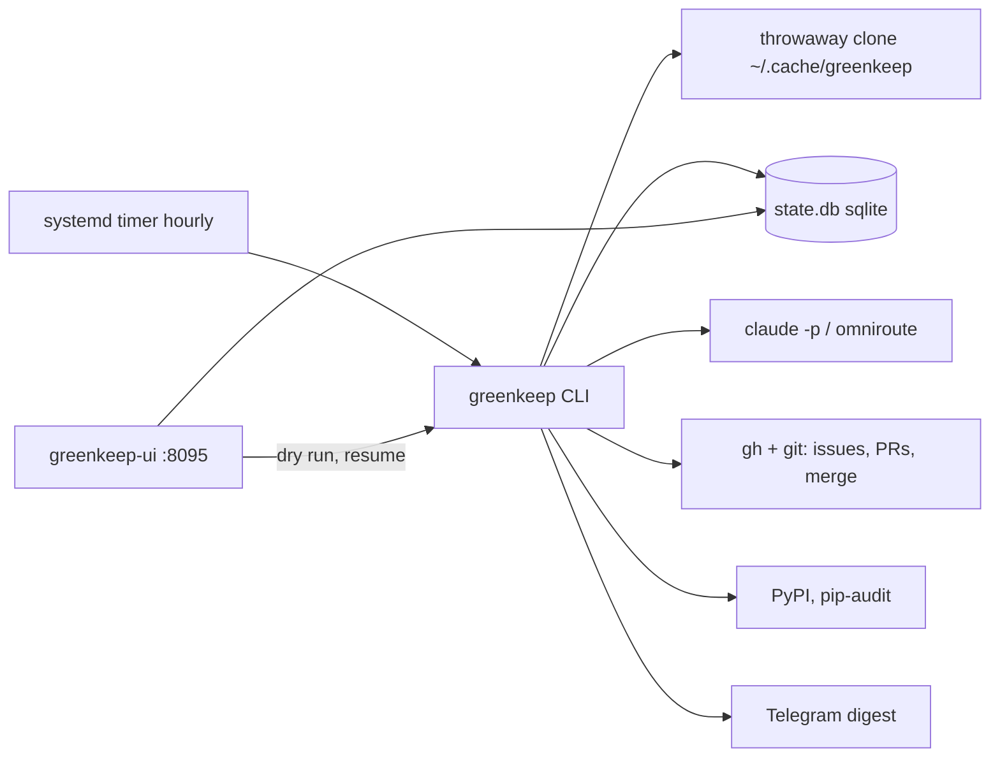

# System design review: greenkeep

Reviewed 2026-11-05 from [logic-map.md](logic-map.md) (step 0) plus local read-only measurements. Kind: batch pipeline run by a systemd timer; one owner, no server, no users. Steps 3 (API) and the cache part of 5 are n/a.

## Assumptions

| Item | Value | Label |
|---|---|---|
| Users | 1 (the owner); dashboard on 127.0.0.1:8095 | measured (logic-map "Dashboard") |
| Tended repos | 22 in config (9 public, 10 private, 3 older) | measured (~/.config/greenkeep/config.toml) |
| Timer | hourly, one scheduled run per day (once-a-day guard), `TimeoutStartSec=4h` | measured (contrib/systemd/greenkeep.timer, .service) |
| Budget | 3 merges weekday, 1 weekend, boost 15 (this machine's config had 60 for one boost) | measured (config.toml) |
| findings in local state.db | 137 rows: 99 merged, 25 parked, 13 open; 10 marks; db 76 KB | measured (state.db, read-only) |
| Merges per day | typically 3-7; peak 35 on 2026-10-29 (boost) | measured (state.db `merged_at`) |
| Log | 7992 lines, 693 KB, cap 5 MB x 4; 201 failed attempts vs 181 "merged" mentions since 2026-10-16 | measured (greenkeep.log) |
| Claude calls logged at DEBUG | 129 across 6 days, max 53 per day; sonnet median 11 s (max 600 s), opus median 16 s (max 56 s) | measured (greenkeep.log; log rotated, older days gone) |
| Prod host | oci-main per memory notes; state.db there is NOT read (no ssh). Local db is the dev copy | assumed |
| Growth | repo count grows by a few per quarter | assumed |

## 0. What exists

Stack, entry points and flow: see [logic-map.md](logic-map.md) (all 25 steps). Facts the design depends on:
- Python CLI `greenkeep` (`cli.main`); sequential loop over repos, one throwaway clone each (`workspace`), shell-outs to `uv`, `ruff`, `pytest`, `pip-audit`, `gh`, `git`, and `claude -p`.
- State: one sqlite file, `sqlite3.connect(path, timeout=60)` in WAL mode (src/greenkeep/state.py:50). Tables `finding(repo, fp)` and `mark(key)`.
- Schedulers: systemd timer hourly; deadline guard `RUN_DEADLINE = 3 h` (src/greenkeep/cli.py:34) under a 4 h kill.
- Ladder rung today: rung 1 (one VM, systemd, embedded DB). Rung 3 partly (log + Telegram digest + dashboard).

## 1. Requirements

One sentence: each day, find safe mechanical fixes in the owner's Python repos and merge them without a human, spending only a flat-rate Claude subscription.

Functional: (1) detect findings per repo; (2) produce a fix; (3) gate and review it; (4) merge via PR; (5) report in one digest. Out of scope: non-Python repos, work repos, forks (config comment), human-review flows, multi-owner use.

Non-functional (all assumed unless noted):
- Scale: 22 repos, 3-7 merges/day. Hard ceiling is the day's budget, not throughput.
- Latency: none per action; a run may take hours. The one real limit is the 3 h `RUN_DEADLINE` (measured, cli.py:34).
- Availability: a missed hour is fine, the timer retries (logic-map step 24/25). Downtime of days is tolerable.
- Consistency: a merge must be recorded exactly once against the budget; a wrong merge must be reverted automatically (step 9).
- Durability: finding/attempt history and the cool-down marks. Loss costs retries, not data; the SQL dump is committed by `backup` (step 25).
- Security: runs `claude -p` and test suites of tended repos on the owner's machine with the owner's `gh` token; read-only tools for all LLM calls except the agent (step 22).
- Observability: INFO story log, DEBUG failures, Telegram digest, dashboard.

## 2. Napkin math

Run 1, dashboard as the only "traffic" (1 owner, 30 s auto-refresh per open tab is far above the real use, so 60 loads/day is generous, assumed):

```
$ napkin.py --dau 1 --req-per-user 60 --peak 3 --server-rps 20 --write-kb 1 --response-kb 20 --retention-years 5
requests/day 60 | peak 0.0 req/s | servers 2 (incl. spare) | shards 1 | replicas 0
storage after 5 years 32.8MB | egress at peak 300bit/s
verdict: rungs 1-2: one good VPS. Ship it.
```

Run 2, the pipeline treated as a request stream (22 repos x 24 hourly runs, the boost worst case, 1 KB read, 5 KB write per touch, assumed):

```
$ napkin.py --dau 22 --req-per-user 24 --peak 1 --server-rps 0.01 --write-kb 5 --response-kb 1 --retention-years 5
requests/day 528 | average 0.0 req/s | cache memory 190.1kB | verdict: one VPS
```

Both say rung 1. The script's "2 servers" is its spare-server floor, not a need. The binding constraint is not RPS but wall time: the loop is serial and each repo costs a clone, `uv sync`, a full baseline suite (30 min hang cap), and LLM calls of 10-25 s typical, up to 600 s measured. 22 repos x (say 3-8 min) is 1-3 h, which is why the 3 h deadline exists and why `unreached` ordering matters (step 6, 24). The 3 h figure is measured from code; per-repo minutes are assumed (the log's `took N min` lines are not in the retained window).

## 3. API contract

n/a. No server API. The CLI flags and the dashboard are described in logic-map "Entry points".

## 4. High-level architecture

Rung 1, as it is. Every box is real.



- Single process, serial repos: one subscription, one set of rate limits, no coordination needed (budget is a global counter in sqlite).
- Throwaway clone: isolates changes from the owner's checkout; cheap, swept after 24 h (step 3).
- sqlite: one writer by design (the run), a reader (dashboard). Count of rows is ~137, so any heavier DB is unjustified.
- OmniRoute off-hours route: moves spend between two subscriptions by `login_hours` (llm.on_login), not a scaling box.
- No queue, cache or LB: nothing waits on a user, and one run a day is the load.

## 5. Data

Engine: sqlite, correct for 1 writer and ~10^2-10^4 rows. Postgres is not warranted.
- `finding(repo, fp)` PK serves every lookup in `State._row` and `merged_today`. `merged_today` scans by `status='merged'` plus `date(merged_at,'localtime')` with no index: at 137 rows (measured) it is free; at 10^5 rows it would still be ms. No index needed.
- `mark(key)` PK: run/unreached/cool-down/hunt/heal/told/dependabot flags; 10 rows (measured).
- Growth: `finding` gains about 10-30 rows/day at most; 5 years is roughly 10^4-10^5 rows, MBs. State is 76 KB today.
- Cache: none in-process except the LLM response cache owned by other projects; here n/a. If gh or PyPI is down, the run reports no findings for that source (steps 11, 21) rather than failing.

## 6. Scale and failure

x10 (220 repos, or a boost with budget 150):
- First to break: wall time. Serial repos at an assumed 3-8 min each gives 11-29 h, far over the 3 h deadline; the tail would be `unreached` forever. Only the owner's most-recently-merged ordering (step 6) keeps rotation fair. A cheaper signal is already there: `Digest` "not reached" line (step 24).
- Second: subscription limits (`UsageLimitError` stops the run at the first repo, step 22/24); measured peak was 53 logged Claude calls/day, so 10x is ~530, likely above a flat subscription's window.
- sqlite and disk are not the limit: 76 KB db, 693 KB log; clones are deleted per repo.
- Next rung: rung 6 shape (workers) only when `unreached` is non-empty on 3 consecutive scheduled runs; first cheaper move is parallel repos (2-3 workers) with a per-repo state transaction.

Failures:
- Claude down or limit hit: not counted, run stops, day left open, next hour retries (step 24). Digest sent each hourly attempt (noise, not a risk).
- gh/GitHub slow or merge refused: polling bounded (10 x 3 s; 30 min on required checks); counts an attempt.
- Single VM gone: nothing is lost that matters; state.db is dumped to `state.sql` and pushed (step 25); runtime config under ~/.config is not backed up (see Risks).
- DB: no concurrency story. A dashboard "Dry run now" and the timer run use separate in-memory/real state; but the dashboard opens state.db read-write (logic-map "Dashboard") and the timer holds it for hours; busy timeout is 60 s and the db is in WAL mode (fixed 2026-11-05; was sqlite's default 5 s).
- Retries: 3 attempts per finding, park, agent escalation (max 2/run), 7-day cool-down after 2 parks. No exponential backoff; cooling is the circuit breaker. No rate limiter, but the daily budget is one.
- Backups: `backup` pushes the dump; the restore has no rehearsal in the repo (not checked).

## 7. Trade-offs

- Serial over parallel: simpler budget accounting and rate-limit safety; costs wall time (the 3 h cap).
- sqlite over a server DB: zero ops; costs a single-writer assumption.
- Fresh clone per repo over the owner's checkout: safety and reproducibility; costs minutes per repo (sync + baseline suite).
- Fail-closed gate (Lean-modelled scope/suppression rules) and Opus review: low false-merge rate; costs LLM calls and some false rejections (201 failed attempts logged vs 99 merged findings).
- Budget per day over per-run: bounded blast radius and spend; costs throughput after an LLM outage.
- Once-a-day guard with hourly timer: free retry after failure; costs an hourly systemd wake.
- Auto-revert only for own `finding` merges (decided, logic-map step 9): consistency with review; the unreviewed merges stay manual.

## 8. Summary

Design: one serial CLI on one VM, sqlite for state, `gh`/`claude` as the external workers. It holds its real load with a wide margin: 22 repos, 3-7 merges/day, 137 rows, 76 KB.

Assumptions that would change it: per-repo run time (assumed 3-8 min; if over 8 min the 3 h deadline binds at ~22 repos); the subscription's per-window call allowance; the production state.db (not inspected).

Next rung: parallel repo workers (not a queue yet) when the digest shows "not reached" on 3 scheduled runs in a row, or the repo count exceeds ~40.

## Risks

- MEDIUM src/greenkeep/cli.py:34,121: `RUN_DEADLINE` of 3 h against a serial loop; at ~40+ repos tail repos starve. Reference logic-map step 24 (`unreached`); first thing that breaks on growth. Measure per-repo minutes before raising it.
- MEDIUM (partly fixed 2026-11-05) src/greenkeep/state.py:49: `sqlite3.connect` now has `timeout=60` and WAL, so a write waits for the run instead of failing after 5 s. Still open: the dashboard opens the db read-write and runs migrations; open it read-only.
- MEDIUM src/greenkeep/llm.py:95: one logged sonnet call took 600 s (measured max, median 11 s); the timeout caps it but a stuck call burns a slot. Check the per-kind timeouts hold the hourly cadence.
- LOW src/greenkeep/state.py:162-169: `merged_today` filters on `date(merged_at,'localtime')` with no index; fine at 137 rows, revisit above ~10^5.
- LOW contrib/systemd/greenkeep.service:13: `TimeoutStartSec=4h` vs hourly timer: an overrunning run blocks later ticks silently (systemd does not overlap a oneshot); acceptable, noted.
- LOW ~/.config/greenkeep/config.toml: the config (repos, boost, login_hours) is not in the `state.sql` backup, so restoring on a new VM loses the tended set. Add it to the backup or document the restore.
- LOW logic-map step 25: hourly retry after Claude outage sends a digest every hour; spam, not failure.
